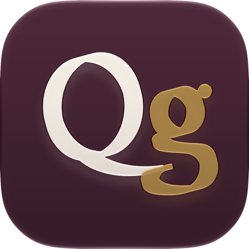
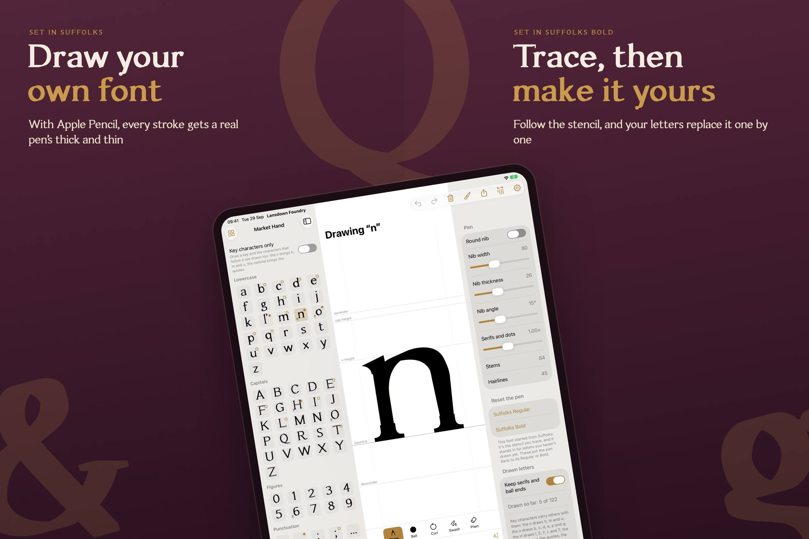
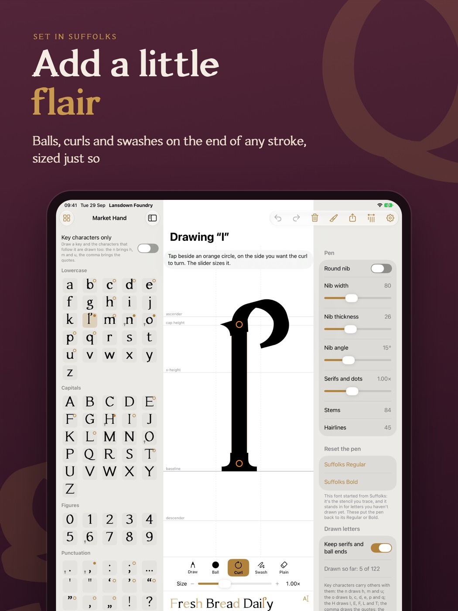
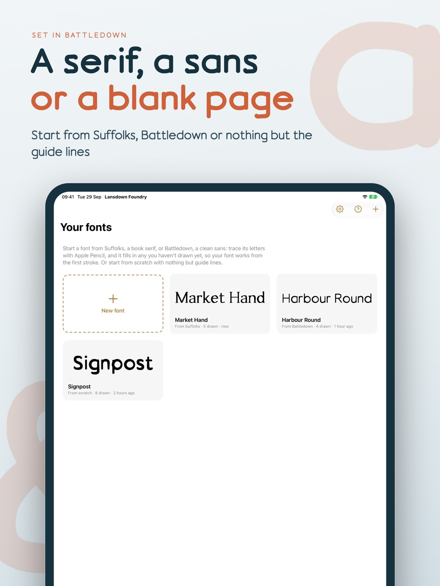
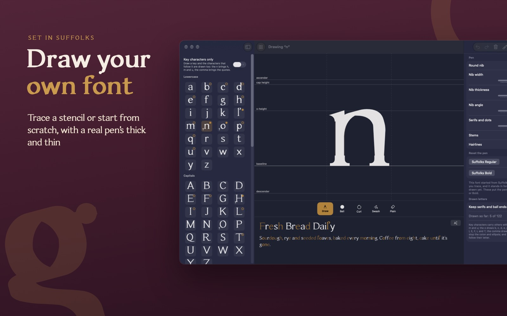

  

<h1 align="center">Lansdown Foundry: draw and export your own fonts</h1>

  <strong>Design a typeface with Apple Pencil, then use it in every app.</strong> 
  <a href="https://lansdownfoundry.thechels.uk/">lansdownfoundry.thechels.uk</a> · Coming soon for iPad and Mac

---

**Lansdown Foundry** is a font maker for iPad and Mac. Draw your letters with Apple Pencil, a mouse, a trackpad or a graphics tablet, and they become a real, installable font. Calligraphic thick and thin strokes, automatic spacing and kerning, accented characters, and Bold, Italic and Bold Italic, all made from your own handwriting or lettering.

  
  

## How it works

1. **Start from a stencil, or from nothing.** Trace the stencil's dashed lines and your letters replace it one by one. Letters you haven't drawn yet stand in from the design, so your font works from the very first stroke.
2. **Draw with a real pen.** Every stroke uses a calligraphic nib, so thick and thin come from the pen itself. Press harder for a heavier stroke, or switch to a round nib for even lines.
3. **Key letters do the work.** Draw the n and you get h, m and u. The o brings b, c, d, e, p and q. Accented letters follow their base letter, so a whole Western European character set comes along.
4. **Add a little flair.** Put a ball, a curl or a swash on the end of any stroke, turn it whichever way you like, and size it with a slider. Serifs follow your stems.
5. **Finished like a real font.** Spacing measured from your letters, automatic kerning, and Bold, Italic and Bold Italic generated from your drawing as one font family.
6. **Use it everywhere.** Install it on your iPad or Mac for Pages, Keynote, Procreate and more, or export **TrueType (TTF)**, **WOFF** and **WOFF2** web fonts.

## Typefaces to build on

Three original typefaces come with the app, free to install, and the [website](https://lansdownfoundry.thechels.uk/) is set entirely in them:

| Typeface | Style | Weights |
|---|---|---|
| **Suffolks** | A warm book serif drawn with a broad pen, with bracketed serifs and ball ends. Named after the Suffolks in Cheltenham. | Regular, Bold |
| **Battledown** | A clean, rounded sans drawn with a round pen. Friendly and even, from captions to headlines. | Regular, Bold |
| **Leckhampton** | A sturdy slab serif with square, heavy serifs. Built to be seen from across the room. | Regular |

Or begin from scratch, with just the guide lines and a font of only what you draw.

  
  

## One purchase, iPad and Mac

Lansdown Foundry is a universal purchase. Buy it once and get it on iPad and Mac, with your fonts kept in step through iCloud Drive and available in the Files app. On Mac, draw with a mouse, a trackpad or a graphics tablet.

- **£19.99**, paid up front: no in-app purchases, no subscription, everything unlocked, including export
- iPad with Apple Pencil, iPadOS 18 or later
- Mac with Apple silicon

## Private by design

No account. No ads. Nothing collected. Your fonts are stored on your iPad and Mac and synced through your own iCloud Drive. We never see them. Read the [privacy policy](https://thechels.uk/app/privacy).

## FAQ

**Can I turn my handwriting into a font?**
Yes. Draw each key letter with Apple Pencil and Lansdown Foundry builds a complete font from your handwriting, with related letters, accents, spacing and kerning.

**What font formats can I export?**
TrueType (TTF) to install on any computer, and WOFF and WOFF2 for websites. You can also install fonts directly on your iPad or Mac.

**Do I need to know about type design?**
No. Start from a stencil and trace. The app handles the technical side: metrics, kerning, weights and italics.

**When is it available?**
Lansdown Foundry is coming soon to the App Store for iPad and Mac. Visit [lansdownfoundry.thechels.uk](https://lansdownfoundry.thechels.uk/) for launch details.

---

## About this repository

This repository is the source of [lansdownfoundry.thechels.uk](https://lansdownfoundry.thechels.uk/), a static HTML and CSS site deployed to GitHub Pages by [`.github/workflows/pages.yml`](.github/workflows/pages.yml) on every push to `main`. The specimen fonts in `fonts/` are the typefaces that come with the app. Dependabot keeps the workflow's actions up to date.

© 2026 Lansdown Foundry · [thechels.uk](https://thechels.uk/)
